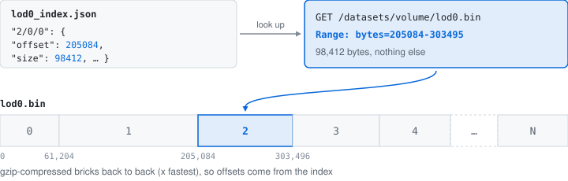
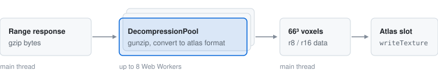

# Network & formats

## Sharded binary

`ShardedDataProvider` looks each brick up in the level's index and fetches exactly its bytes with one HTTP Range request.



```json
{
  "entries": {
    "0/0/0": { "offset": 0, "size": 61204, "min": 0, "max": 45, "avg": 12 },
    "1/0/0": { "offset": 61204, "size": 143880, "min": 0, "max": 198, "avg": 61 },
    "2/0/0": { "offset": 205084, "size": 98412, "min": 0, "max": 87, "avg": 23 }
  }
}
```

A brick whose `max` is below the empty threshold (set by data type and window) is marked empty (`w` = 255) without a request. Bricks are gzip-compressed, typically to 30–60 % of their size for dense CT/MRI and 10–30 % for sparse volumes, and decompressed off the main thread:



## OME-Zarr

`ZarrDataProvider` reads OME-Zarr with zarrita.js. Chunk boundaries don't match the brick grid, so a worker pool fetches the chunks a brick overlaps, decompresses them and cuts out the 66³ brick. There is no index of brick statistics: a brick is found empty after its first load, and isn't requested again.

## Network statistics

The stats panel shows throughput (last 10 s), total bytes and request count. With `?bench=1`, the report also gives `chunkBytes` (downloaded chunk payloads) and `borderOnlyBytes` (payloads only a brick's ghost border needed so far). Shared shard indexes are left out of both, so the percentage refers to chunk payloads, not all traffic; payloads of cancelled bricks may be missing.

## Data types

| | `uint8` | `uint16` | `int16` | `float32` |
|---|---|---|---|---|
| Atlas format | `r8unorm` | `r16unorm`, or `r16float` without [support](/reference/webgpu) | `r16float` | `r16float` |
| Stored value | value / 255 | value / 65535, or value − 2048 in `r16float` | raw | raw |
| Normalised by | type range | type range | data range | data range |
| Full atlas | 274 MiB | 548 MiB | 548 MiB | 548 MiB |

`float64` is read as `float32`. The data range is the OMERO window when present, else the 0.1–99.9th percentile of the coarsest level. Half precision holds integers up to ±2048 exactly, enough for CT in Hounsfield units.

## Windowing

A window maps the sub-range of values that matters (a 12-bit sensor stored as `uint16`, soft tissue in CT) to 0–1:

```wgsl
fn applyWindow(density: f32, windowCenter: f32, windowWidth: f32) -> f32 {
    let minVal = windowCenter - windowWidth * 0.5;
    return clamp((density - minVal) / windowWidth, 0.0, 1.0);
}
```
