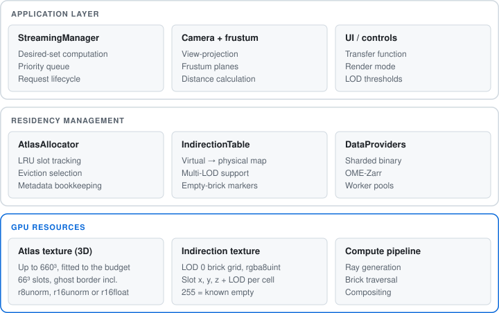

# System overview

Technical deep-dive into Kiln's virtual texturing system for volumetric data.

Kiln implements a **virtual texturing** system that decouples the logical volume address space from physical GPU memory. A bounded atlas cache holds only the currently needed bricks, while the rest of the dataset remains on the server and is streamed on demand.

The rest of this section covers each layer in turn:

- **[Virtual texturing](/architecture/virtual-texturing)** — brick decomposition, the indirection table, and the atlas texture.
- **[Streaming manager](/architecture/streaming)** — desired-set computation, the priority queue, and LRU eviction.
- **[Network & formats](/architecture/network-formats)** — HTTP Range streaming, compression, and supported data types.
- **[Memory budget](/architecture/memory-budget)** — VRAM accounting.
- **[Design decisions](/architecture/design-decisions)** — the rationale behind the key choices.
