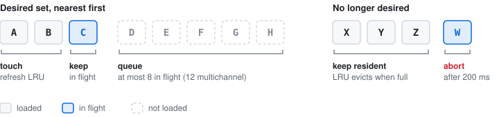

# Streaming manager

`StreamingManager` (`src/streaming/streaming-manager.ts`) decides which bricks belong in the atlas, loads them in priority order and evicts the rest.

## Desired set

Recomputed every 10 frames and as soon as the camera stops. Starting at the coarsest level, each brick is

1. dropped if it is outside the view frustum, known to be empty, or not reached by any ray ([ray guidance](#ray-guided-selection)),
2. split into its children if its screen-space error is above the threshold,
3. otherwise added to the desired set.

```typescript
const traverse = (bx, by, bz, lod) => {
  const aabb = getBrickAABB(bx, by, bz, lod);
  if (!isAABBInFrustum(aabb, frustumPlanes)) return;

  const dist = distance(cameraPos, aabbCenter(aabb));
  const projectedError = (getVoxelWorldSize(lod) / dist) * projectionFactor; // pixels per voxel of this level
  if (lod > 0 && projectedError > maxPixelError && finerLodExists(lod - 1)) {
    for (child of getChildren(bx, by, bz, lod)) traverse(child.x, child.y, child.z, lod - 1); // 1 or 2 per axis
  } else {
    desiredSet.add({ lod, bx, by, bz, distance: dist });
  }
};
```

`maxPixelError` defaults to 8 pixels (URL parameter `sse`). Between 0.7× and 1× the threshold a brick stays split only if its children are already resident, which stops LOD flicker during gestures. Because the error is measured in pixels, it adapts to screen resolution, field of view and anisotropic voxel spacing.

While the camera moves, the set is still recomputed so stale requests are cancelled, but new requests wait until the interaction ends.

## Base load

The coarsest level is loaded completely and pinned before any refinement. Its order is tuned for time to first image:

1. **Cheapest bricks first:** sorted by the number of source chunks they need (`estimateBrickCost`), then centre-out.
2. **Ramp-up:** two requests at first, doubling with each completion up to the concurrency limit, so the first brick doesn't share the link with all the others.
3. **Channel-major:** every brick's first visible channel before any second channel. A brick is committed as soon as its first channel arrives, so a one-channel image appears after about 1/N of the base time (milestone `baseChannel0Complete`).
4. **Visible channels only:** hidden channels aren't streamed; showing one backfills the resident bricks.
5. **First frame now:** the first committed brick skips the accumulation-reset debounce.

On a 10 MB/s, 40 ms link this brought first content from 3.3 s to 0.6 s for a 4-channel embryo with whole-plane chunks, and from 13.6 s to 0.5 s for a 4-channel fly brain with 128³ chunks. The full base takes as long as before; it is bandwidth-bound.

## Refinement

- **Progressive multichannel commit:** a refined brick is committed when its first visible channel arrives. Until the other channels land, they show the ancestor's data resampled into the new slot, so nothing changes visually. If the ancestor isn't in the CPU cache, the brick waits for all channels.
- **Worker chunk cache:** each worker keeps up to 8 of the largest chunks it has seen (64–256 MB), enough to cover the planes a Z range of whole-plane chunks needs.

On the same link: first new detail after a zoom went from 11.5 s to 3.2 s (4-channel embryo) and from 4.4 s to 1.0 s (4-channel yeast); a pan across the embryo re-converges in 2.1 s instead of 5.4 s with 97 % fewer bytes.

## Ray-guided selection

On by default; `?rayguide=0` turns it off.

Frustum culling keeps bricks hidden behind opaque material or outside the clip box. Ray guidance skips them:

1. The shader sets one bit per LOD 0 brick cell a ray enters before it terminates. In ISO mode it also marks the neighbouring cells its gradient taps read.
2. The renderer reads the bits back every 4 frames, and once more when accumulation converges.
3. Bricks finer than the base level are desired only if a ray entered one of their cells within the last 16 rendered frames. Counting frames rather than time means a converged, idle image keeps what it showed.

The base level is never skipped. Slice mode marches no rays and turns guidance off. The stats panel and `?bench=1` report how many bricks were skipped; the savings are largest in views that refine deep into the finest levels.

## Request scheduling

After each desired-set update, the manager

- aborts in-flight requests for bricks that are no longer desired, after a 200 ms grace period so brief LOD changes don't thrash,
- refreshes the LRU timestamp of loaded bricks that are still desired,
- queues missing bricks nearest first, with at most 8 requests in flight (12 for multichannel).



## LRU eviction

When the atlas is full, `AtlasAllocator` (`src/streaming/atlas-allocator.ts`) reuses the least recently used slot:

```typescript
allocate(frame: number): AllocationResult | null {
  if (freeList.length > 0) return { slot: freeList.pop(), evicted: null };

  let victim = -1, oldestFrame = Infinity;
  for (slot of usedSlots) {
    if (pinned.has(slot) || frame - lastUsedFrame[slot] < MIN_EVICTION_AGE) continue;
    if (lastUsedFrame[slot] < oldestFrame) { oldestFrame = lastUsedFrame[slot]; victim = slot; }
  }
  if (victim === -1) return null; // nothing evictable: the brick stays desired and retries
  return { slot: victim, evicted: slotMetadata[victim] };
}
```

The pinned base level is never evicted, and slots used within the last 30 frames are protected so a burst of new bricks can't evict each other. The streaming manager then points the evicted brick's indirection cells back at its ancestor on screen, or marks them empty if that ancestor is empty.
