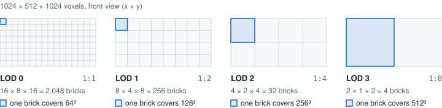
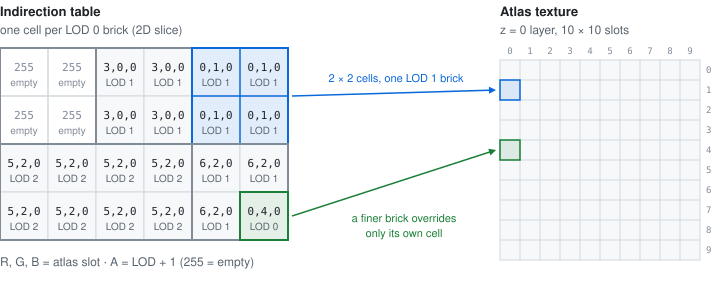
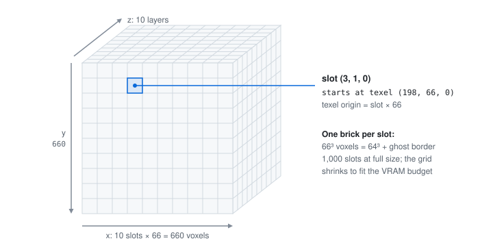
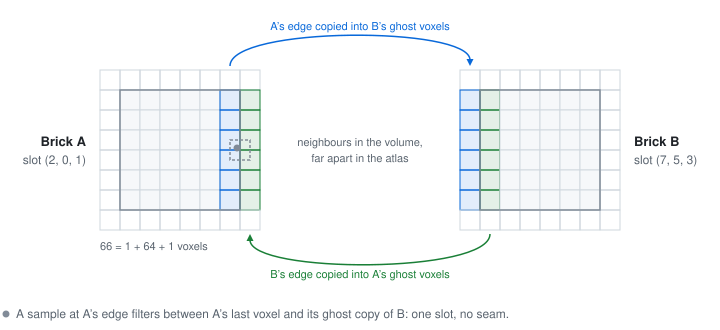

# Virtual texturing pipeline

Volumetric data exhibits strong spatial coherence: only a small working set of bricks is visible at any moment. By virtualizing the address space, a large logical volume maps onto a bounded physical cache.

## 1. Brick decomposition

Kiln addresses every dataset as a multi-resolution **brick pyramid**:

Each brick is 64³ **logical voxels**, stored as 66³ **physical voxels** with a 1-voxel border for correct trilinear interpolation at brick boundaries.

Where the bricks come from depends on the format. OME-Zarr datasets bring their own pyramid levels; workers assemble each 66³ brick on demand from the Zarr chunks it overlaps. The [sharded binary format](/data/sharded-binary) is bricked ahead of time by the conversion CLI, into per-LOD binary files with a JSON index of byte offsets and statistics (min/max/avg intensity).

The diagram shows a uniform 2:1 pyramid. Native OME-Zarr pyramids can downsample each axis independently (for example XY only, for anisotropic microscopy), so a brick has 1 or 2 children per axis, and a level's brick covers a correspondingly shaped region.

## 2. Indirection table

The **indirection table** is a 3D texture (`rgba8uint`) dimensioned to the LOD 0 brick grid. Each texel encodes:

| Channel | Purpose                                           |
|---------|---------------------------------------------------|
| R       | Atlas slot X coordinate (0-9 at full grid)        |
| G       | Atlas slot Y coordinate (0-9 at full grid)        |
| B       | Atlas slot Z coordinate (0-9 at full grid)        |
| A       | LOD level + 1 (0 = not loaded, 255 = known empty) |

When a coarse LOD brick is loaded, it fills **multiple cells** in the indirection table proportional to its coverage. In a 2:1 pyramid a LOD 2 brick covers a 4×4×4 region in the LOD 0 grid, so 64 cells are updated with the same atlas coordinates. This enables seamless LOD transitions without shader-side LOD selection logic.

When a finer LOD brick loads, it **overwrites** only its specific cell, leaving coarser LOD data in adjacent cells. The shader always reads the cell corresponding to the current sample position, automatically getting the finest available resolution.

## 3. Atlas texture

The **atlas** is a single 3D texture organized as a grid of 66³ slots. Its size adapts to fit a VRAM budget — up to `660³` (a 10×10×10 grid), shrinking for multichannel datasets (see below). The texture format depends on the source data:
- **`uint8`**: `r8unorm` (1 byte per voxel)
- **`uint16`**: `r16unorm` (2 bytes per voxel, bit-exact) when the device has `texture-formats-tier1` and accepts `r16unorm` as a filterable 3D texture (see [WebGPU notes](/reference/webgpu)); otherwise `r16float` storing value − 2048, exact up to 4096 (12-bit data), mapped back to value / 65535 in the shader
- **`int16` and `float32`**: `r16float` (2 bytes per voxel) — raw values in half precision; the shader normalises them by the data range
- **Fallback**: if `r16float` is unsupported, the atlas drops to `r8unorm` (16→8-bit, quality loss)

> **Note:** The maximum atlas grid (`660³`, 1,000 slots) is defined in `src/core/config.ts`. The actual size is chosen at startup by `computeAtlasGrid()` to fit a VRAM budget — `numChannels × atlasSize³ × bytesPerVoxel` stays under the budget (default ~1.3 GiB, overridable via `ViewerOptions.atlasBudgetBytes`). Single- and dual-channel datasets keep the full `660³`.

Each slot stores 66³ voxels. At the full `660³` grid (1,000 slots):
- **8-bit**: 287,496 bytes per slot × 1,000 slots = **~274 MiB** VRAM
- **16-bit**: 574,992 bytes per slot × 1,000 slots = **~548 MiB** VRAM

### Multichannel atlas

For multichannel datasets (up to 4 channels), each channel gets its own atlas texture, so VRAM scales with channel count. To stay within budget the atlas grid shrinks as channels increase — e.g. a 4-channel 16-bit dataset uses a 528³ atlas per channel (~1.1 GiB total) instead of the full 660³ (~2.1 GiB). The indirection table is shared across all channels — all channels of a given brick use the same atlas slot indices. See [Multichannel](/rendering/multichannel) for details.

The 1-voxel **ghost border** duplicates neighboring brick data to enable hardware trilinear filtering without seams:

