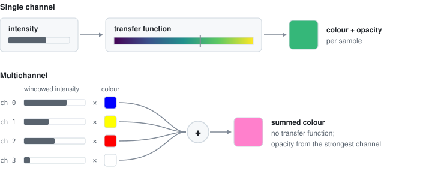

# Multichannel Rendering

> **Beta** — Multichannel rendering is new in v0.4.0 and still stabilizing; the API and compositing behaviour may change. See [Known Issues](/reference/issues) for current limitations.

Kiln can render OME-Zarr datasets with up to 4 channels simultaneously. Each channel is rendered with independent colour, window/level, and visibility controls. Compositing uses additive blending rather than transfer functions.

## Overview

Single-channel rendering maps voxel intensity through a transfer function to produce colour and opacity. Multichannel rendering takes a different approach: each channel contributes a user-defined colour weighted by its intensity, and the contributions are summed additively. This is a common display approach for fluorescence microscopy, where each channel typically represents a different stain or marker.



## Supported formats

Multichannel rendering works with OME-Zarr datasets that have a channel (`c`) axis:

- **OME-NGFF v0.4 and v0.5**
- **Any 1–4 source channels** (defaults to the first four; pick others from the channel names in the Controls panel)
- **Supported dtypes:** `uint8`, `uint16`, `int16`, `float32`
- OMERO metadata is used for per-channel window auto-leveling when available

The Kiln sharded binary format is single-channel only.

## Source channels and timepoints

Each channel's name in the Controls panel is a picker: choose any source channel for
that display slot, or **Remove from view**. Picking a channel that is already shown
swaps the two slots. **+ Add channel** appears below the rack while fewer than four
slots are used and the dataset has channels not yet shown. Datasets with a time axis
get a **Time** card above the rack: drag the scrubber, click the step buttons, or press
`,` and `.` (Shift: ±10). Timepoints are numbered from **1** in the UI; API and URL
indices start at **0**. Channel labels come from OMERO metadata when present.

Every change switches in place: the dataset is not reopened, workers and their
chunk caches stay, and the camera and render settings are kept. The previous picture
stays on screen at base resolution while the new bricks land and detail re-streams.
Channels that remain selected are served from the brick and chunk caches instead of
being downloaded again, and the CPU brick cache is keyed by source channel and timepoint,
so returning to a timepoint you have already seen is cheap. Time-only changes
preserve display settings; a slot whose channel changed takes that channel's OMERO
colour, window and visibility. Choosing one channel in the multichannel viewer (or
several in the single-channel viewer) opens the other viewer, whose controls match
that shader. This version does not animate or prefetch timepoints.

```typescript
const viewer = await KilnViewer.create(canvas, url, {
  sourceChannels: [5, 1], // source channels 6 and 2, in that display order
  timepoint: 3,          // fourth timepoint
});
// Renderer channel indices remain slots: setChannelColor(0, ...) affects source channel 6.
console.log(viewer.metadata.sourceChannelCount, viewer.metadata.timepointCount);
viewer.setSourceSelection({ sourceChannels: [5, 1], timepoint: 4 }); // next timepoint, same slots
console.log(viewer.getState().sourceChannels, viewer.getState().timepoint);
```

`setSourceSelection` is synchronous and validates first: an invalid selection throws
and changes nothing. A different channel count rebuilds the atlas and renderer on the
same device, so read `viewer.renderer` and `viewer.streamingManager` per use rather
than caching them. Local Zarr uses the same options. Custom providers may implement
`setSourceSelection`; providers without it (including Kiln sharded binary) reject
explicit selections. Invalid, duplicate or out-of-range indices fail explicitly. Time
and channel axis sizes must match across pyramid levels.

Share links preserve `sourceChannels=5,1&timepoint=3`. The existing `channels` URL
parameter continues to describe display colours, visibility and windows.

## Per-channel controls

Each channel has three independent controls, plus auto contrast in the demo:

### Colour

A 4-component RGBA colour. The RGB components define the channel's display colour; the alpha component acts as an intensity weight.

Default colours:
| Channel | Colour |
|---------|--------|
| 0 | Blue (0.0, 0.0, 1.0) |
| 1 | Yellow (1.0, 1.0, 0.0) |
| 2 | Red (1.0, 0.0, 0.0) |
| 3 | White (1.0, 1.0, 1.0) |

### Window / Level

Per-channel intensity windowing remaps a sub-range of the raw intensity to the visible 0–1 output. This is essential for datasets where channels have very different intensity ranges (common in fluorescence).

When OMERO metadata is available in the OME-Zarr store, Kiln reads per-channel `window.start` / `window.end` values and applies them automatically. Otherwise, ranges are derived from the data during base LOD loading.

### Visibility

Channels can be toggled on/off. A hidden channel (alpha = 0) contributes nothing to the composite and is not streamed; when it is shown again, the bricks already on screen are backfilled with its data.

### Auto contrast

The multichannel demo's **Auto** button on a channel fits that channel's window to its values on the loaded base level, ignoring the darkest and brightest 0.5 % and zero background. `A` fits all visible channels. Apps can build the same from `viewer.streamingManager.getChannelHistogram(channel, bins)`, which returns the channel's value distribution over the loaded base level (or `null` until it has loaded).

## Compositing

Multichannel compositing is **additive**: each channel's colour is weighted by its windowed intensity and the results are summed. This applies to all supported render modes:

| Mode | Multichannel behaviour |
|------|----------------------|
| **DVR** | Per-channel colour × windowed intensity, summed additively, then composited front-to-back |
| **MIP** | Per-channel maximum intensity tracked independently, then composited via additive blending |
| **Slice** | Per-channel colour at slice position, blended by opacity-weighted average |

ISO (isosurface) mode is not supported for multichannel datasets.

Transfer functions are **not used** in multichannel mode. Colour is determined entirely by the per-channel colour and intensity windowing.

## API

### Reading channel count

```typescript
const viewer = await KilnViewer.create(canvas, 'https://example.com/multichannel.ome.zarr');
const numChannels = viewer.renderer.numChannels; // 1–4
```

### Setting channel colour

```typescript
// setChannelColor(channel, r, g, b, a?)
viewer.renderer.setChannelColor(0, 0.0, 1.0, 0.0, 1.0); // channel 0 → green
viewer.renderer.setChannelColor(1, 1.0, 0.0, 0.0, 0.5); // channel 1 → red, half intensity

// Hide a channel by setting alpha to 0
viewer.renderer.setChannelColor(2, 1.0, 1.0, 1.0, 0.0); // channel 2 → hidden
```

### Setting channel window/level

```typescript
// setChannelWindow(channel, center, width) — both in normalised 0–1 range
viewer.renderer.setChannelWindow(0, 0.3, 0.4); // channel 0: centre=0.3, width=0.4
viewer.renderer.setChannelWindow(1, 0.5, 1.0); // channel 1: full range
```

### Responding to auto-leveling

When per-channel intensity ranges are derived during base LOD loading, the `onChannelWindowsChanged` callback fires. Use this to update UI controls:

```typescript
viewer.onChannelWindowsChanged = () => {
  // Channel windows have been updated from data or OMERO metadata.
  // Read the current values from the renderer and update your UI.
  const cw = viewer.renderer.channelWindowCenter; // Float32Array(4)
  const ww = viewer.renderer.channelWindowWidth;  // Float32Array(4)
};
```

## Multichannel demo

A dedicated multichannel demo is included at `examples/multichannel-viewer/`:

```bash
bun run dev:multichannel   # http://localhost:3001
```

The demo provides per-channel UI controls (source channel picker, colour picker, window sliders with raw data values, visibility toggle, Auto contrast) and supports URL-shareable state.

### URL parameters

| Parameter | Format | Description |
|-----------|--------|-------------|
| `dataset` | URL | OME-Zarr dataset URL |
| `channels` | `r,g,b,a,vis,min,max;...` | Per-channel state, semicolon-separated |
| `mode` | `dvr`, `mip`, `slice` | Render mode |
| `slice` | `x,y,z,showX,showY,showZ` | Slice plane positions and visibility |
| `cam` | `rx,ry,dist,tx,ty,tz` | Camera state |
| `up` | `x`, `y`, `z`, `-x`, `-y`, `-z` | Camera up axis |
| `scale` | 0.25–1.0 | Render resolution |
| `pyramid` | `native`, `legacy` | Level model, as in the [single-channel viewer](/guide/url-parameters) |
| `sourceChannels`, `timepoint` | zero-based indices | Source selection, see [Source channels and timepoints](#source-channels-and-timepoints) |

Channel state encodes each channel as `r,g,b,a,visible,windowMin,windowMax` (0–255 for RGB, 0–1 for the rest), separated by semicolons:

```
?channels=51,102,255,1.00,1,0.10,0.80;255,230,51,1.00,1,0.20,0.90;255,51,51,1.00,0,0.00,1.00
```

## Known limitations

- **Max 4 channels at once** — GPU uniforms use `vec4f` for per-channel data, limiting the display to 4 channels. Datasets with more channels show the first 4 by default; pick others with `sourceChannels` or the channel picker.
- **No transfer function** — Multichannel mode uses additive compositing with direct per-channel colours. The transfer function editor is not available.
- **No ISO mode** — Isosurface rendering is not supported for multichannel datasets.
- **VRAM scales with channel count** — Each channel gets its own atlas texture, so the atlas grid shrinks as channels increase to stay within the VRAM budget. See [Virtual texturing → Multichannel atlas](/architecture/virtual-texturing#multichannel-atlas) for the grid sizes.
- **Network load scales with visible channels** — Each brick requires one fetch per channel, so a 4-channel dataset issues up to 4× the requests of a single-channel one. Hidden channels are not streamed; the base level loads channel by channel so the first channel is visible early.
- **Kiln binary format** — The sharded binary format is single-channel only. Multichannel requires OME-Zarr.
